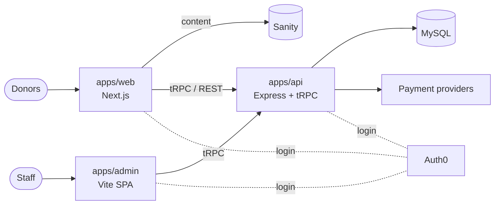

<p align="center">
  <picture>
    <source media="(prefers-color-scheme: dark)" srcset="docs/assets/logo-dark.svg" />
    
  </picture>
</p>

<p align="center">
  The donation platform of <a href="https://gieffektivt.no">Gi Effektivt</a> (Effekt Foundation):<br />
  the websites, the API and the admin that route donations to the most cost-effective charities we know of.
</p>

<p align="center">
  <a href="https://gieffektivt.no">gieffektivt.no</a> ·
  <a href="https://giveffektivt.dk">giveffektivt.dk</a> ·
  <a href="https://geeffektivt.se">geeffektivt.se</a>
</p>

---

## What's in here

One repository, one [pnpm](https://pnpm.io) workspace.

| Path                                 | What                                                                                         | Runs on                                              |
| ------------------------------------ | -------------------------------------------------------------------------------------------- | ---------------------------------------------------- |
| [`apps/web`](apps/web)               | The websites and Min Side (donor pages). Next.js, content in Sanity, Sanity Studio built in. | Vercel                                               |
| [`apps/admin`](apps/admin)           | The internal admin for the ops team. Vite + React SPA.                                       | [admin.gieffektivt.no](https://admin.gieffektivt.no) |
| [`apps/api`](apps/api)               | The API: Express + tRPC, payments, recurring agreements, receipts, scheduled jobs.           | Cloud Run behind a load balancer                     |
| [`apps/api/prisma`](apps/api/prisma) | MySQL schema and migrations, plus the generated dev and e2e data.                            | Cloud SQL                                            |
| [`packages/api`](packages/api)       | `@effekt/api`: the API's tRPC types and shared schemas for the website.                      | –                                                    |
| [`functions`](functions)             | Small Cloud Functions: the scheduler dispatcher and DMARC reports.                           | Cloud Functions                                      |



The same website code serves all three countries. Norway uses this API; Sweden runs its own
instance of it, and its Min Side is being phased out; Denmark talks to Giv Effektivt's own backend,
[donation-platform](https://github.com/giveffektivt/donation-platform), through a REST adapter.
The website is moving from REST to tRPC one call at a time ([docs/web-trpc.md](docs/web-trpc.md)).

## Getting started

You need Node 24, Docker and pnpm (`corepack enable` picks the pinned version).

```bash
pnpm install
pnpm dev:env:up    # MySQL with fake data, a mock login, the API on :5050 and the admin on :3001
pnpm web:dev       # the website on :3000 (copy apps/web/.env.example to .env.local first)
```

The admin opens already signed in, and nothing local touches Auth0 or production.
`pnpm -s dev:token` prints an API token, `pnpm dev:env:down` stops the stack and
`pnpm dev:env:reset` starts over with fresh data. `pnpm lint`, `pnpm typecheck` and `pnpm test`
check every package; `pnpm api:test`, `pnpm web:test` and `pnpm admin:test` check one
([docs/tooling.md](docs/tooling.md)).

## How we work

- Every change is a pull request to `main`, reviewed by the [code owners](.github/CODEOWNERS) of the files it touches.
- Checks on each PR: `QualityAssurance` (Cloud Build: format, types and API tests), Semgrep, zizmor and the website's lint, unit and [e2e](docs/e2e.md) suites, including a full-stack run against a real API and database.
- Add the `preview` label to get a full preview environment for the PR ([docs/preview-environments.md](docs/preview-environments.md)).
- Merging deploys: Cloud Build migrates the database and ships the API and the admin, Vercel builds the websites. There is no separate staging.

## Documentation

Everything lives in [`docs/`](docs).

| Doc                                                       | About                                              |
| --------------------------------------------------------- | -------------------------------------------------- |
| [website.md](docs/website.md)                             | The website: running it, structure, Sanity Studio  |
| [web-trpc.md](docs/web-trpc.md)                           | tRPC on the website and the Danish REST adapter    |
| [admin-building.md](docs/admin-building.md)               | Building admin pages: what to read, rules, testing |
| [admin-design.md](docs/admin-design.md)                   | The admin's design system                          |
| [admin-features.md](docs/admin-features.md)               | What the admin must let people do                  |
| [preview-environments.md](docs/preview-environments.md)   | Per-PR preview environments                        |
| [e2e.md](docs/e2e.md)                                     | Website end-to-end tests                           |
| [deploy.md](docs/deploy.md)                               | Cloud Build deploys and the newest-commit guard    |
| [regranting.md](docs/regranting.md)                       | The regranting system                              |
| [regranting-downstream.md](docs/regranting-downstream.md) | Downstream regrants                                |
| [timestamps.md](docs/timestamps.md)                       | Timestamps and the database clock                  |
| [functions.md](docs/functions.md)                         | The Cloud Functions                                |
| [tooling.md](docs/tooling.md)                             | Scripts, versions and tools across the workspace   |
| [API routers](apps/api/src/trpc/routers)                  | The API's tRPC routers (the API's reference)       |

Plans and records of finished work: [overhaul-plan.md](docs/overhaul-plan.md) (the admin and tRPC
overhaul), [admin-deployment.md](docs/admin-deployment.md) (rolling out the new admin) and
[monorepo-cutover.md](docs/monorepo-cutover.md) (moving the website into this repository).
